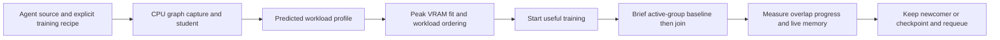

# Interpreting the released predictor in scheduling

The released time and busy outputs are useful **workload-ordering indicators**.
They retain nominal physical units and include regression supervision, but their
ranking accuracy does not establish calibrated whole-job time or GPU capacity.
The scheduler now keeps these hints separate from measured timing evidence.

## What the training code actually does

| Output | Training and construction | Scheduler interpretation |
| --- | --- | --- |
| Wall/GPU step cost | Teacher log-time regression plus pairwise ordering loss; student combines label regression, teacher regression and RankNet distillation | Relative per-step work on the selected hardware |
| Epoch cost | Wall-step cost × explicit optimizer steps; no independent epoch head | Relative per-epoch work; multiply by remaining epochs to rank total remaining work |
| Busy | Soft hurdle: probability of nonzero activity × positive NVML magnitude; regression/classification plus ordering losses | Heavier/lighter workload ordering, never additive GPU capacity or SM occupancy |
| Average/peak VRAM | Bucket-oriented loss; deployment rounds upward to decimal 100 MB | Initial fit/reservation from predicted peak; an exact observation supersedes it; live bounds remain active |

Primary code: [teacher losses](https://github.com/JustinLinKK/PerfSeer-predictor/blob/paper-release/portable/model/starter.py),
[selected student objective](https://github.com/JustinLinKK/PerfSeer-predictor/blob/paper-release/student_training/pretrain_objective.py),
[student output construction](https://github.com/JustinLinKK/PerfSeer-predictor/blob/paper-release/student_training/runtime/student.py).
The student objective uses hard-label, teacher-soft and rank terms with weights
0.5 each, relational embedding loss 0.05 and memory-upper loss 0.2.

The release trains on `measured_single_step`: an epoch contains one measured
optimizer step. Deployment can multiply by a declared count, but this does not
measure an agent's full data loading, validation or checkpoint overhead. The
[portable contract](https://github.com/JustinLinKK/PerfSeer-predictor/blob/paper-release/portable/README.md)
explicitly describes derived multi-step scaling and uncalibrated uncertainty.

## What the quality numbers mean

The release evaluates wall/GPU **step ordering** on measured ratios >=1.10,
and separately close pairs from 1.10 to <1.25. Busy ordering uses measured
differences >=5 percentage points, not a relative 5% threshold. Tied predictions
receive half credit. These evaluation eligibility thresholds are not deployment
rules for treating close predictions as equal or for admitting GPU work.

For example, the [released sealed-test report](https://github.com/JustinLinKK/PerfSeer-predictor/blob/paper-release/reports/comparison.json)
contains:

| Student | Wall ordering accuracy | Median wall relative error | P90 wall relative error |
| --- | ---: | ---: | ---: |
| S_A100 | 94.88% | 11.23% | 33.50% |
| S_A10G | 99.60% | 3.23% | 10.31% |

These are historical test workloads, not new-agent calibration. The identical
epoch/step error columns reflect one-step epochs. An output ratio of 1.13× is a
relative cost estimate; ordering validation alone does not establish a 13% wall
time difference. Busy ratios likewise are not occupancy or overlap guarantees.

## Runtime correction

Previously, `estimate_batch_options` selected nominal student seconds **before**
available measured epoch timing. That could put an uncalibrated prediction into
drain-time, trial-amortization and replay calculations. Released students now set
`requires_measured_runtime=True`, so those seconds-based calculations require
observations. This does **not** require an exclusive profile before admission:
the prediction-first path below uses relative work and live progress instead.
The old seconds/percent APIs remain diagnostic compatibility interfaces.

The default planner ranks eligible jobs by busy order (higher when idle, lower
when joining), then `epoch_cost × remaining_epochs`, then measured remaining time,
explicit priority and stable ID. Unknown indicators sort after known indicators;
they are never zero work. Inputs and optimizer-step counts remain batch-specific.
These are hints from one hardware-matched student, not scores mixed across models.
The backend-aware mode retains measured-benefit/risk ranking and uses workload
indicators within its priority tie-break. Existing admission guards remain active.

With complete predicted profiles, cooperative runners skip solo-reference
collection. Other runners start solo; missing predictions use the existing
measurement fallback. Predictions never create measured profiles or synthetic
wall-clock gains. CPU tests verify invariant
decisions under common time rescaling and monotonic busy remapping, and that
even high busy scores do not reject a candidate by an invented capacity sum.

The two actual PetFinder source predictions choose candidate_01 as the heavier
idle anchor and candidate_00 as the lighter joining candidate. This verifies
interface and policy behavior; it is not an A10G throughput experiment. The
90% VRAM budget and absence of submission-time priority are preserved.

## Full workflow: replace exclusive profiling, retain online feedback

The review found three functional blockers in the old integration: student
seconds displaced observed timing; released VRAM was explicitly excluded from
admission; and cold-start trials still measured a solo reference for every new
job. The prior PetFinder check demonstrated graph/inference compatibility, not
the absence of those profiling barriers. All three paths are now separated.



`predict_profile_options` returns step cost, epoch cost, busy indicator, rounded
average/peak VRAM, batch, hardware and model hash. This virtual profile is explicitly
predicted; it is never inserted into measured runtime/memory tables. Cached source,
dependency, recipe, batch, normalizer and model identities prevent stale reuse.
Missing/incompatible predictions trigger the documented fallback rather than
fabricated zero-cost or zero-memory profiles.

For eligible cooperative jobs with complete profiles from the same model and
hardware, the live trial freezes step-cost weights `w_i`. It measures optimizer-step
seconds `t_i` for the running group, then lets the newcomer join and measures the
new group. The comparison is:

```text
before = sum(w_i / t_i_before) for existing jobs
after  = sum(w_i / t_i_after)  for existing jobs plus newcomer
relative_work_gain = after / before
```

Both independent window halves must improve by the configured margin. A shared
rescaling of model costs cancels out. This is measured progress weighted by
predicted work, not proof of a whole-job makespan gain; cost errors can affect
the decision. Busy is used only to nominate candidates, never as an additive
capacity percentage. The state machine goes from `pre_add` directly to
`measure_overlap`, with zero `reference_barrier`/`reference` phases. Predicted
weights cannot enter the measured drain-time calculation or be saved as solo
timing observations. Batch/signature changes invalidate the frozen trial.

Peak memory includes a reservation for active jobs before their allocation fully
appears in telemetry. The 90% budget, live-memory gate and runner allocator limit
remain active; predicted peaks are estimates, not calibrated safety bounds.
A rejected peak cannot silently fall through to solo dispatch. Explicit
calibration jobs remain opt-in; normal MLEvolve jobs are not classified as probes.

The host executor sets `cooperative_trial` only when generated code provides
`script_scheduler_context`, resume restoration and safe points after complete
optimizer updates. The two saved PetFinder drafts **lack these hooks**, so their
CPU prediction success alone does not qualify them for this overlap path. The
README and `examples/cold_start_runner.py` specify the integration contract.
State-machine tests simulate compliant runners; no new GPU throughput experiment
or production-worker restart was performed in this change.

## Recommendation for the PetFinder hooks

For the current drafts, move their training loop into the structure demonstrated
by [the cooperative runner](../examples/cold_start_runner.py): initialize
`script_scheduler_context` before CUDA allocation, restore the resume checkpoint,
and supply `BEFORE_TRAIN`, `STEP` and `EPOCH` safe points. A step safe point belongs
after a **complete optimizer update**, not halfway through backward or gradient
accumulation. Save model, optimizer, LR scheduler, AMP scaler when used, Python/
NumPy/Torch/CUDA RNG, epoch/global-step and sampler/data position. Printing an
epoch metric or saving model weights alone does not satisfy this contract.

Longer term, put this loop in a shared, versioned runner and let the code agent
generate model construction, batch preparation and scalar loss. Use the same
training recipe object for capture and execution, so precision, optimizer,
accumulation and shapes cannot silently diverge. This is a proposal for the host
framework; the current MLEvolve AST recognizer expects inline calls and must be
adapted to recognize an approved shared-runner capability rather than blindly
setting `cooperative_trial=True` on arbitrary scripts.

Make a bounded pause/resume smoke check a pre-submission capability check: compare
an uninterrupted tiny run with the same run interrupted after an optimizer step
and resumed in a fresh process. Verify parameter/optimizer state, RNG restoration,
the next batch/data position, completed-step accounting and progress preservation.
Only then advertise cooperative capability; keep failed or unsupported runners
on the solo path. This check validates control integration, and does not require
collecting a GPU performance profile for every pending job.
