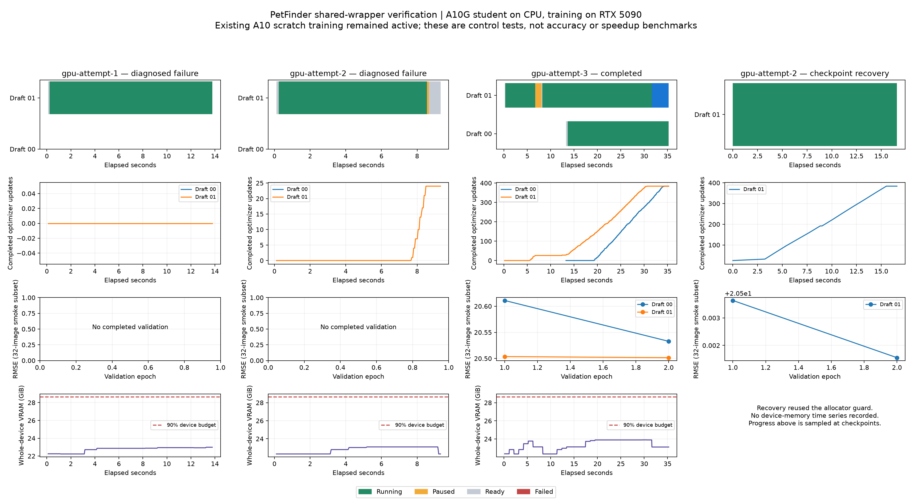

# Shared training wrapper verification — 2026-10-27 UTC

Both real PetFinder drafts completed 384 optimizer updates (two epochs) using
the shared wrapper. Draft 01 paused at update 28 and resumed in a new process;
Draft 00 joined it, and both made progress concurrently. Their simultaneous
RUNNING interval was 17.95 seconds. This includes control/startup time and is not
a measurement of GPU kernel overlap or a scheduling speedup.

| Draft | A10G busy indicator | Relative epoch cost | Rounded predicted peak VRAM | Completed updates |
|---|---:|---:|---:|---:|
| 00 | 15.35 | 1.000 | 900 decimal MB | 384 |
| 01 | 17.99 | 1.134 | 1,000 decimal MB | 384 |

The higher-busy Draft 01 was the anchor. Draft 00 entered through `pre_add` and
`measure_overlap`. The scheduler accepted the addition using live optimizer-step
windows with the student costs as weights. There were **zero separate solo
profile measurements**. Peak whole-device use was 24,470 MiB of 32,607 MiB (75.0%),
including unrelated A10 scratch training, below the 90% budget. Both jobs wrote
validation-selected models and ID-aligned test submissions.

**Scope:** actual CPU inference with released `S_A10G`, real PetFinder images,
and local RTX 5090 training. The harness explicitly injects a declared A10G
predictor; production hardware matching remains unchanged. Busy and time are
relative indicators. This experiment does not measure A10G accuracy, calibrated
runtime, or whole-workload scheduling speedup. The 32 validation images used in
the bounded smoke run are diagnostic only. Ordinary adapted drafts retain their
original 992-row validation split and three epochs of eight batches.

The complete CPU regression finished with **433 passed, 11 subtests passed,
3 skipped and 1 deselected**. The deselected NVIDIA-document applicability test
is a previously reproduced, unrelated failure. CUDA is hidden for that suite;
the live GPU experiment is recorded separately. Exact CPU recovery checks compare
model, optimizer, random states, batch-position evidence, selected weights and
validation history against an uninterrupted run. Pausing on the last batch of
an epoch also preserves pending validation.

Two live attempts exposed problems that were fixed:

- Strict deterministic CUDA adaptive-pooling backward is unsupported by
  PyTorch. Version 1 now exposes a determinism policy, keeping the original model
  operators and warning under `best_effort`. Supported deterministic CPU replay
  remains bitwise exact; bitwise GPU equality is not promised for that operator.
- An immediate Resume could overwrite PAUSED before the old parent process
  consumed the child's exit. Resume now remains pending until that process exits;
  a later Pause or Cancel cancels the pending resume. A focused regression covers
  the transition. The original failed attempt's update-25 checkpoint was also
  recovered unchanged and completed all 384 updates.

The raw drafts, earlier failures and checkpoints were retained. Other training
was not stopped: the A10 scratch controller retained the same PID/start identity
and advanced from epoch 18 to 19 during this work. A100 pilots remained paused.

See `gpu-result.json`, `predictions.json`, `recovery-complete.json`,
`verification.json` and `regression-tests.txt` for numerical evidence. Full local
timelines, execution results and checkpoints remain under
`/home/justin/MLEvolve/record/shared-wrapper-20261027/`.
